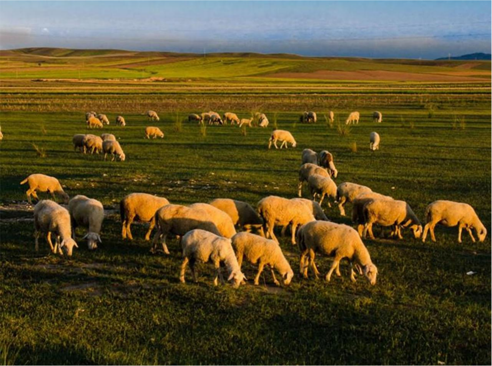

<div align="center">

# 🐑 我的滩羊手记

**一个关于宁夏盐池滩羊的记录型网站 — 纯原生 HTML / CSS / JavaScript**

[](#)
[](#)
[](#)
[](#)

### ▶ [**在线预览 https://shenyicong.github.io/ningxia-tan-sheep-web/**](https://shenyicong.github.io/ningxia-tan-sheep-web/)

</div>

<p align="center">
  
</p>

---

## 📌 项目简介

以「记录者」的第一人称视角，讲述宁夏盐池滩羊的产地、吃法、风物与饮食文化。

技术上刻意**不引入任何框架与依赖**——没有 Bootstrap、没有 jQuery、没有构建工具，全部用原生 API 手写。目标是在不依赖生态的前提下，把交互体验做到接近现代前端的水准。

> 「我不是专家，只是个记录者。」—— 站点首页的自我定位。

---

## 📄 页面结构

| 页面 | 文件 | 内容 |
|---|---|---|
| 首页 | `index.html` | 主视觉、数据概览、探索旅程、最新笔记、入口卡片 |
| 探索笔记 | `categories.html` | 四类笔记 + 分类标签页切换 |
| 影像志 | `gallery.html` | 图片墙 + 分类筛选 + 灯箱查看 |
| 滩羊计划 | `projects.html` | 进行中的记录项目与进度条 |
| 关于我 | `about.html` | 个人介绍与记录缘由 |
| 加入探索 | `login.html` | 登录 / 注册表单与实时校验 |
| 数据流图 | `data-flow.html` | 系统数据流图（课程设计文档） |

---

## ⚡ 交互功能

全部交互由 341 行原生 JS 实现，按功能模块拆分：

| 模块 | 实现方式 |
|---|---|
| 🌗 明暗主题 | CSS 变量 + `localStorage` 持久化，刷新不丢失 |
| 📱 响应式导航 | 移动端折叠菜单，滚动时吸顶变色 |
| 🗂️ 分类标签页 | 点击切换笔记分类，无刷新重渲染 |
| 🖼️ 图片筛选 + 灯箱 | 按类别过滤，点击图片弹出全屏查看，支持说明文字 |
| ✅ 表单校验 | 邮箱正则 + 实时校验（输入即反馈），错误提示定位到字段 |
| 👤 登录注册 | 基于 `localStorage` 模拟用户表，注册后可直接登录 |
| 🎬 滚动动画 | `IntersectionObserver` 触发淡入，非滚动监听 |
| 🔢 数字增长 | 进入视口时从 0 滚动到目标值 |
| 📊 进度条 | 项目完成度按视口动画填充 |
| 🔔 Toast 提示 | 轻量自实现，替代 `alert` |

---

## 🎨 设计要点

**用 CSS 变量做主题，而不是两套样式表**

`:root` 中定义颜色令牌，`[data-theme="dark"]` 只重写颜色变量。切换主题时无需操作任何元素的 `class`，整站颜色一次性响应。

**三档响应式断点**

`992px / 768px / 480px` 分别对应平板横屏、平板竖屏、手机。移动端优先保证图片与文字不溢出，导航折叠为汉堡菜单。

**动画只碰 `transform` 与 `opacity`**

所有过渡与关键帧动画（`fadeInUp` / `fadeIn` / `pulse`）都不触发重排，滚动时保持流畅。

---

## 🗂️ 目录结构

```
ningxia-tan-sheep-web/
├─ index.html          首页
├─ categories.html     探索笔记
├─ gallery.html        影像志
├─ projects.html       滩羊计划
├─ about.html          关于我
├─ login.html          登录 / 注册
├─ data-flow.html      数据流图
├─ style.css           全站样式（571 行，含主题变量与响应式）
├─ script.js           全站交互（341 行，模块化函数）
└─ image/              站点图片资源（17 张）
```

---

## 🚀 本地运行

纯静态站点，无需构建：

**方式一：直接打开**

双击 `index.html` 即可。

**方式二：直接访问线上版（推荐，无需任何环境）**

👉 **https://shenyicong.github.io/ningxia-tan-sheep-web/**

页面已通过 GitHub Pages 托管，手机、平板、任何浏览器都能直接打开，不受本地文件限制。

**方式三：本地服务器（改代码调试用）**

```bash
# Python 3
python -m http.server 8000

# Node.js
npx serve .
```

启动后按终端打印的地址在浏览器打开即可调试。

---

## 📄 说明

《Web 前端技术》课程设计作品，页面结构、样式与交互代码均为本人独立完成。

站点内容为虚构的个人记录视角，图片素材仅用于课程演示。
